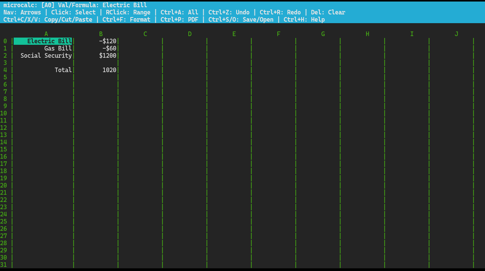

# microcalc 📊

`microcalc` is a lightning-fast, lightweight, and feature-rich terminal-based spreadsheet application written in C using `ncurses`. Designed with modern terminal workflows in mind, it bridges the gap between classic retro computing and modern desktop utility by offering features like system clipboard integration (Wayland and X11), PDF export, dynamic formula evaluation, and a snappy, zero-latency mouse interface.

---

---

## ✨ Features

- **Blazing Fast TUI:** Built on `ncurses` with instant mouse response times (`mouseinterval(50)`).
- **Advanced Formula Engine:** Two formula systems, kept separate. **Visual shorthand** chains cells with operators, left to right: `=A0sA2` is `A0+A2`, and `=A0sA1SA2` uses `s` (add), `S` (subtract), `x`/`*` (multiply), `d`/`/` (divide); parentheses group, e.g. `=(A0sA1)xA2`. Prefix an operator with `r` to apply it across the rectangle between two cells: `=A0rsA2` is `A0+A1+A2`, `=A0raA2` averages them, and `rS`/`rd` step through in order (A0-A1-A2, A0/A1/A2). `rm`, `rM`, `rc`, and `rx` give min, max, count, and product. The bare forms `a`, `m`, `M`, and `c` (e.g. `=A0aA2`) act on the two cells only. **Mathematic** uses `+ - * /`, `%`, and parentheses with cell references, e.g. `=A0+A1*(B2-5)`. The two systems mix freely. Everything runs left to right with no operator precedence, so `=A0+A1*2` is `(A0+A1)*2`; parentheses change the order, and `=A1rsA13*A15` adds A1 through A13, then multiplies by A15. Excel-style functions (`SUM`, `AVG`, etc.) and `A0:A6` ranges are not formula syntax; they are converted when a Gnumeric file is imported. Formulas update automatically when the cells they reference change.
- **System Clipboard Integration:** Seamlessly copy and paste spreadsheet ranges as TSV/CSV blocks directly to/from your system clipboard (`wl-copy`/`wl-paste` for Wayland, or `xclip`/`xsel` for X11).
- **Undo & Redo Stacks:** Full multi-level `Ctrl+Z` (Undo) and `Ctrl+R` (Redo) support.
- **Printable PDF Export:** Export your sheet directly into a clean, standalone PDF document complete with dynamic column-width layout and Helvetica typography.
- **File I/O:** Save and load using a native `.mc` pipe-delimited format (preserving formulas and color states) or flat `.csv` files. Import Gnumeric `.gnumeric` / `.gnm` / `.xml` files as well.
- **Visual Cell Highlighting:** Tag cells for financial tracking (Green for profit, Red for loss).
- **Smart Formatting & Quick Actions:** One-click number/currency standardization (`Ctrl+F`), quick-sum formulas via double-clicking, and path auto-completion (`Tab`) in file dialogs.

---

## ⌨️ Controls & Cheatsheet

### Navigation & Mouse
| Control | Action |
| :--- | :--- |
| **Arrow Keys** | Navigate active cell cursor |
| **Left Click** | Select a cell (Double-click active cell to edit) |
| **Right Click** | Drag or set a multi-cell selection range |
| **Double Left Click** | Quick-sum selected range into an empty target cell |

### Editing & Clipboard
| Control | Action |
| :--- | :--- |
| **Enter / Return** | Edit the contents of the selected cell |
| **Del / Backspace** | Clear active cell or current selection |
| **Ctrl + Z** | Undo last action |
| **Ctrl + R** | Redo last action |
| **Ctrl + A** | Toggle select all cells |
| **Ctrl + C / X / V** | Copy, Cut, or Paste selection range |
| **Ctrl + F** | Clean up / standardize cell formatting ($20.00 / 20.00) |
| **+, -, 0 Keys** | Tag cell color (Green profit, Red loss, Normal) |

### File I/O & Extras
| Control | Action |
| :--- | :--- |
| **Ctrl + S / Ctrl + O / Ctrl + L** | Save / Open (`.mc` native or `.csv`; open also accepts `.gnumeric` / `.gnm` / `.xml`). Ctrl+L also opens |
| **Ctrl + P** | Export printable sheet as a PDF document |
| **Ctrl + H** | Open built-in help cheatsheet |
| **q / Q** | Quit application |

---

## 🚀 Building and Installation

`microcalc` uses **CMake** for clean, cross-platform compilation.

### Prerequisites
Make sure you have a C compiler (`gcc`/`clang`), `cmake`, and `ncurses` development libraries installed.

* **Debian / Ubuntu / Mint:**
  ```bash
  sudo apt install build-essential cmake libncurses-dev
  ```
* **Arch Linux:**
  ```bash
  sudo pacman -S base-devel cmake ncurses
  ```

### Build Instructions
1. Clone or navigate to the repository directory.
2. Create a build directory and compile:
   ```bash
   mkdir build
   cd build
   cmake ..
   make
   ```
3. Run the application:
   ```bash
   ./microcalc
   ```
   *(Optional)* You can open a file directly on launch:
   ```bash
   ./microcalc budget.mc
   ```
   *(Optional)* For a multi-sheet Gnumeric file, pick the sheet with `-p` (1-based):
   ```bash
   ./microcalc -p 2 workbook.gnumeric
   ```
   Without `-p`, a multi-sheet file asks which sheet to open. `-p` only works with Gnumeric files.

---

## 📄 File Formats

- **`.mc` (Native):** Preserves formulas, cell values, and color states in a compact pipe-delimited structure (`row|col|color|text`).
- **`.csv` (Flat Data):** Standard comma-separated values format for interoperability with other spreadsheet tools (note: formulas evaluate to static text/numbers upon export).
- **`.gnumeric` / `.gnm` / `.xml` (Import only):** Gnumeric spreadsheets (plain XML or gzip-compressed). One sheet is imported: sheet 1 for single-sheet files, otherwise the one you pick (see `-p` above). Numbers and text are kept. Excel's operator precedence is preserved by adding parentheses (e.g. `=A1+A2*2` becomes `=A0+(A1*2)`). Formulas are converted to Microcalc syntax: `SUM`, `AVERAGE`, `MIN`, `MAX`, and `COUNT` over one range become range operators (e.g. `=SUM(C3:C14)` becomes `=C2rsC13`). `SUM` with several arguments, or inside arithmetic, expands to cell sums (e.g. `=SUM(C3:C4,C6)` becomes `=(C2+C3+C5)`). Other formulas are kept as-is and shown as invalid (red) because Microcalc can't evaluate them; formulas longer than 63 characters or that Microcalc would read differently are skipped. Text starting with `=` and text longer than 63 characters are not preserved, and booleans or errors are imported as text. Text is collapsed to one line.