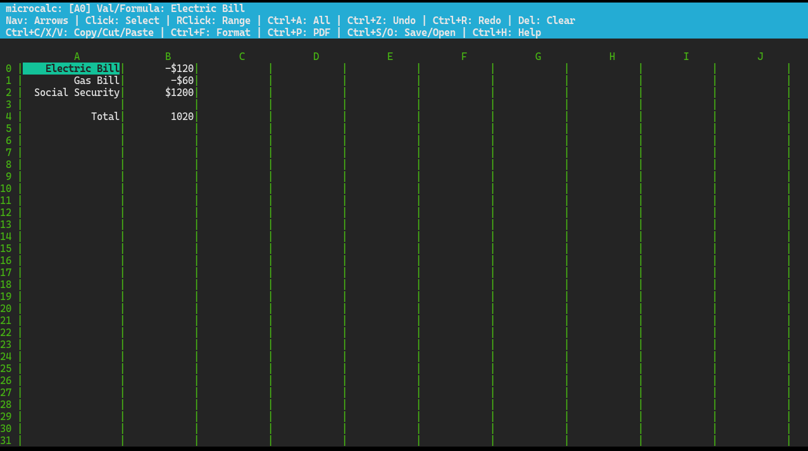

# microcalc 📊

`microcalc` is a lightning-fast, lightweight, and feature-rich terminal-based spreadsheet application written in C using `ncurses`. Designed with modern terminal workflows in mind, it bridges the gap between classic retro computing and modern desktop utility by offering features like system clipboard integration (Wayland and X11), PDF export, dynamic formula evaluation, and a snappy, zero-latency mouse interface.

---

---

## ✨ Features

- **Blazing Fast TUI:** Built on `ncurses` with instant mouse response times (`mouseinterval(50)`).
- **Advanced Formula Engine:** Supports arithmetic operations, cell references (`=A0+A1`), and range functions (`SUM`, `AVG`, `MAX`, `MIN`, `COUNT`) with automatic dependency resolution.
- **System Clipboard Integration:** Seamlessly copy and paste spreadsheet ranges as TSV/CSV blocks directly to/from your system clipboard (`wl-copy`/`wl-paste` for Wayland, or `xclip`/`xsel` for X11).
- **Undo & Redo Stacks:** Full multi-level `Ctrl+Z` (Undo) and `Ctrl+R` (Redo) support.
- **Printable PDF Export:** Export your sheet directly into a clean, standalone PDF document complete with dynamic column-width layout and Helvetica typography.
- **File I/O:** Save and load using a native `.mc` pipe-delimited format (preserving formulas and color states) or flat `.csv` files.
- **Visual Cell Highlighting:** Tag cells for financial tracking (Green for profit, Red for loss).
- **Smart Formatting & Quick Actions:** One-click number/currency standardization (`Ctrl+F`), quick-sum formulas via double-clicking, and path auto-completion (`Tab`) in file dialogs.

---

## ⌨️ Controls & Cheatsheet

### Navigation & Mouse
| Control | Action |
| :--- | :--- |
| **Arrow Keys** | Navigate active cell cursor |
| **Left Click** | Select a cell (Double-click active cell to edit) |
| **Right Click** | Drag or set a multi-cell selection range |
| **Double Left Click** | Quick-sum selected range into an empty target cell |

### Editing & Clipboard
| Control | Action |
| :--- | :--- |
| **Enter / Return** | Edit the contents of the selected cell |
| **Del / Backspace** | Clear active cell or current selection |
| **Ctrl + Z** | Undo last action |
| **Ctrl + R** | Redo last action |
| **Ctrl + A** | Toggle select all cells |
| **Ctrl + C / X / V** | Copy, Cut, or Paste selection range |
| **Ctrl + F** | Clean up / standardize cell formatting ($20.00 / 20.00) |
| **+, -, 0 Keys** | Tag cell color (Green profit, Red loss, Normal) |

### File I/O & Extras
| Control | Action |
| :--- | :--- |
| **Ctrl + S / Ctrl + O** | Save / Open (`.mc` native or `.csv`) |
| **Ctrl + P** | Export printable sheet as a PDF document |
| **Ctrl + H** | Open built-in help cheatsheet |
| **q / Q** | Quit application |

---

## 🚀 Building and Installation

`microcalc` uses **CMake** for clean, cross-platform compilation.

### Prerequisites
Make sure you have a C compiler (`gcc`/`clang`), `cmake`, and `ncurses` development libraries installed.

* **Debian / Ubuntu / Mint:**
  ```bash
  sudo apt install build-essential cmake libncurses-dev
  ```
* **Arch Linux:**
  ```bash
  sudo pacman -S base-devel cmake ncurses
  ```

### Build Instructions
1. Clone or navigate to the repository directory.
2. Create a build directory and compile:
   ```bash
   mkdir build
   cd build
   cmake ..
   make
   ```
3. Run the application:
   ```bash
   ./microcalc
   ```
   *(Optional)* You can open a file directly on launch:
   ```bash
   ./microcalc budget.mc
   ```

---

## 📄 File Formats

- **`.mc` (Native):** Preserves formulas, cell values, and color states in a compact pipe-delimited structure (`row|col|color|text`).
- **`.csv` (Flat Data):** Standard comma-separated values format for interoperability with other spreadsheet tools (note: formulas evaluate to static text/numbers upon export).